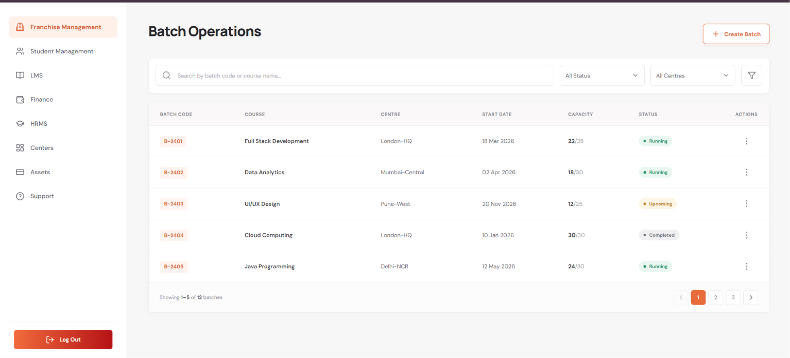

# Batch Operations – Listing, Search & Pagination



A React + Express assessment project for listing training batches with server-side search, filtering and pagination. Batch records are intentionally stored in a backend JavaScript array; no database is used, as required.

## Features

- React dashboard inspired by the supplied UI reference.
- Express REST API: `GET /api/batches`.
- Search by batch code or course name (case-insensitive).
- Combined status and centre filters.
- Server-side pagination (5 records per page by default).
- Loading, API error and empty states.
- Request cancellation to avoid stale responses and debounced search.
- Basic API hardening with Helmet, restricted CORS, rate limiting and input validation.
- API health endpoint and automated backend tests.

## Requirements

- Node.js 18 or later
- npm

## Run locally

### 1. Backend

```bash
cd backend
npm install
cp .env.example .env
npm run dev
```

The API runs at `http://localhost:5000`.

### 2. Frontend

Open a second terminal:

```bash
cd frontend
npm install
cp .env.example .env
npm run dev
```

Open `http://localhost:5173`.

## API

### `GET /api/batches`

Query parameters:

| Parameter | Default | Description                           |
| --------- | ------: | ------------------------------------- |
| `page`    |     `1` | 1-based page number                   |
| `limit`   |     `5` | Records per page; allowed 1–50        |
| `search`  |   empty | Matches batch code or course name     |
| `status`  |   empty | `Running`, `Upcoming`, or `Completed` |
| `centre`  |   empty | Exact centre name                     |

Example:

```http
GET /api/batches?page=1&limit=5&search=react&status=Completed&centre=Bengaluru-Tech
```

Successful response:

```json
{
  "success": true,
  "data": [],
  "pagination": {
    "page": 1,
    "limit": 5,
    "totalRecords": 0,
    "totalPages": 0,
    "hasNextPage": false,
    "hasPreviousPage": false
  },
  "filters": {
    "statuses": ["Running", "Upcoming", "Completed"],
    "centres": [
      "Bengaluru-Tech",
      "Delhi-NCR",
      "London-HQ",
      "Mumbai-Central",
      "Pune-West"
    ]
  }
}
```

`GET /api/health` can be used for a basic health check. Invalid page, limit or status values return HTTP 400 with a JSON error response.

## Tests

```bash
cd backend
npm test
```

## Project structure

```text
batch-operations/
├── backend/
│   ├── src/
│   │   ├── controllers/
│   │   ├── data/
│   │   ├── middleware/
│   │   ├── routes/
│   │   ├── services/
│   │   ├── utils/
│   │   ├── app.js
│   │   └── server.js
│   └── tests/
├── frontend/
│   └── src/
│       ├── components/
│       ├── hooks/
│       ├── pages/
│       ├── services/
│       └── styles/
├── .gitignore
└── README.md
```
